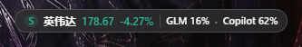
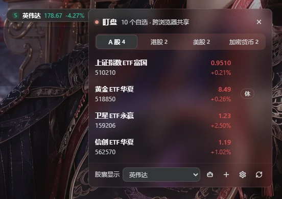
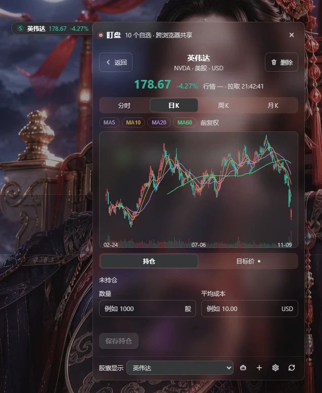
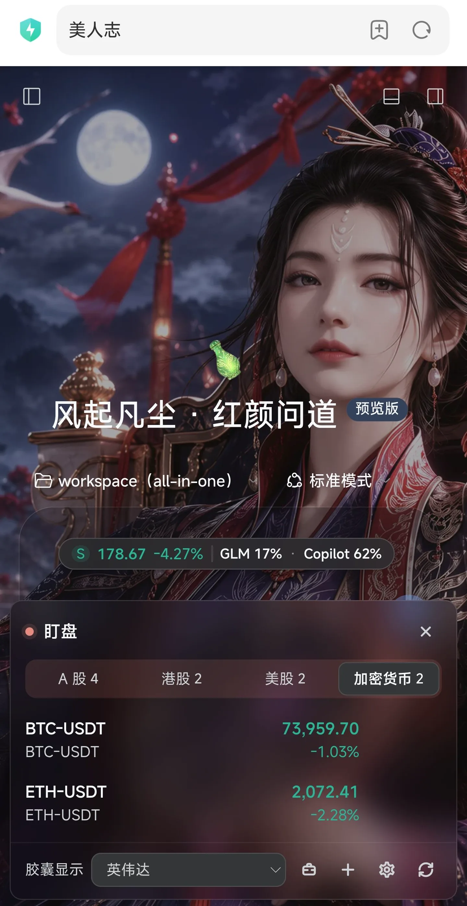
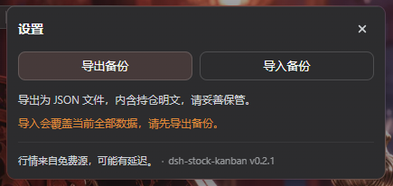
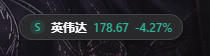

# dsh-stock-kanban

<p align="center">
  
</p>

DSH 插件：多市场盯盘与持仓查看。悬浮胶囊 + A 股 / 港股 / 美股 / 加密货币分组自选 + 持仓盈亏 + 目标价 + 分时 / 日 / 周 / 月 K 线。

  

## 悬浮胶囊

- 显示自选标的的名称、现价、涨跌幅；自由拖动，位置按访问端浏览器记忆（视口内钳位）。
- 达到买入 / 卖出目标价时显示 **B / S** 标记（见上图）；行情过期时明确暂停，不伪装成最新价。
- 点击展开面板；拖动胶囊时面板自动收起。
- 与 [quota-watch](https://www.npmjs.com/package/@iasiv5/dsh-quota-watch) 同装时自动合并为**单枚两段胶囊**（股票段 | 额度段），整枚一次拖动、共享位置记忆，见下文「与 quota-watch 联动」。

## 盯盘面板



- **分组自选**：A 股 / 港股 / 美股 / 加密货币四个分组（ETF 归入上市市场，是类型不是分组）；同一标的只出现一次。
- **拖拽排序**：整行拖动（悬停浮现把手）/ 触屏长按 / 行聚焦 `Alt+↑↓`，三条路径等效；顺序存 DSH 实例跨浏览器共享，footer「胶囊显示」下拉与面板列表实时同序。
- **只看持仓**：footer 公文包开关，开启后只显示有持仓的标的，并在每行显示盈亏金额与比例。
- **状态标注**：休市 / 行情过期有独立徽标（见图中「休」），绝不静默展示旧数据。
- **持仓汇总**：按报价币种分别汇总（USD 与 USDT 不合并）；缺行情时明确标注「不完整」。

## 详情与 K 线



- **分时 / 日K / 周K / 月K**：自绘 SVG（含成交量与 MA5 / 10 / 20 / 60），无 CDN 依赖；切周期卡片几何恒定、零位移。
- **持仓与目标价**：数量与平均成本自动计算市值、浮动盈亏与比例；买入 / 卖出目标价，阈值重叠时区块内确认。
- **时间口径**：行情时间与拉取时间分开标注；加载 / 出错 / 成图三态等高，不跳动。

## 移动端



- 视口 ≤480px 时面板自动转**底部 sheet**，按钮全部可达。
- 触屏长按起拖排序（未满长按不影响原生滚动）；手机 / 平板浏览器开箱即用。

## 设置与备份



- **导出**：结构化 JSON（schemaVersion 1）；**导入**：覆盖式（双重校验、显式确认）。
- 页尾脚注：数据边界说明与插件版本号（构建期注入，与发布版本一致）。

## 安装与升级

在能访问 DSH runtime 的机器上：

```bash
# 开发态链接安装（正式部署可 npm pack 后 add 包）
dsh plugin --profile web add "link:/path/to/dsh-stock-kanban"
# 或使用 tarball：
# npm pack && dsh plugin --profile web add ./dsh-stock-kanban-<版本>.tgz
# 随后重启 DSH 服务，使 host 端路由生效：
sudo systemctl restart deepseek-harness.service
```

- **验证已激活**：浏览器打开 DSH，右下角应出现「盯盘」胶囊；也可访问 `http://<dsh>/stock-kanban/health`，返回的 JSON 含 `driver` 字段。
- **升级**：对同一路径再执行一次 `add`（link 安装）。
- **卸载**：`dsh plugin --profile web remove dsh-stock-kanban`。卸载不删除业务数据，重装后自动读回。卸载前建议先在设置中导出备份。

## 数据与隐私

| 数据 | 存放位置 | 共享范围 |
|---|---|---|
| 自选、持仓、目标价 | DSH 服务端 `~/.dsh/storages/stock_kanban.json`（DSH storage 单元；该服务缺失时回退 `~/.dsh/stock-kanban/data.json`，health 的 `driver` 字段可查当前驱动） | 同一 DSH 实例的全部浏览器共享 |
| 胶囊位置（自由坐标） | 访问端浏览器 `localStorage["dsh-stock-kanban:float-position"]` | 按浏览器独立 |
| 上次市场、只看持仓、均线显隐、胶囊展示标的 | 访问端浏览器 `localStorage["stock-kanban:ui:v1"]` | 按浏览器独立 |

- **要点：业务数据跨浏览器共享，界面偏好只存在当前浏览器。** 合并显示额度段是会话内状态，不落盘。
- 不同 DSH 实例（如本机 desktop 与远端 web）的数据互相独立，迁移用手动导出 / 导入。
- 备份文件是 JSON 明文，包含持仓数据，请自行妥善保管。导入为覆盖模式，会替换当前全部数据。
- 行情请求只携带市场代码，**不发送任何持仓数据**给行情提供方。
- 写操作路由强制同源校验（Origin / Sec-Fetch-Site），并限制请求体积。
- 多页面一致：每次变更带版本号（rev）。旧页面用过期数据提交时会收到 409，并提示「数据已被其他页面更新，已刷新，请重试」，不静默覆盖。

## 行情来源与限制

免费、无 Key、无需注册。全部接口都可能有延迟与限流；插件显示行情时间与拉取时间，失败与过期状态会明确标注，不承诺实时，也不把旧数据伪装成最新。

| 市场 | 快照 / 列表 | 分时 | K 线 | 复权口径 |
|---|---|---|---|---|
| A 股 / ETF | 腾讯 qt.gtimg.cn（批量） | 腾讯 minute/query（proxy 域主、web 域备） | 腾讯 fqkline | **前复权（qfq）** |
| 港股 | 同上（同批） | 同上 | 同上 | **不复权**（接口无 qfq 键，图表如实标注） |
| 美股 | 东方财富 ulist（批量）/ stock/get | trends2（北京时间为轴） | kline klt=101/102/103 | **前复权（fqt=1）** |
| 加密货币 | OKX 现货公开 REST（ticker / tickers） | 5m×288 ≈ 24h | candles 1D / 1W / 1M | 无复权概念 |

- **搜索**：A 股 / 港股 / ETF 用本地标的池（`data/*.json`，约 1 万条，来自参考项目）加腾讯 smartbox；美股用 smartbox；加密货币用 OKX 交易对清单。搜索源不可用时明确提示，不展示虚构结果。
- **直接输入代码添加**：必须先通过行情校验，实际取到有效价格才会加入。

## 与 quota-watch 联动（可选，CEP v1）

本插件与 `@iasiv5/dsh-quota-watch`（GLM Coding Plan / GitHub Copilot 额度悬浮胶囊）通过窗口内 CustomEvent 协议联动。协议规格见 `docs/interop/capsule-embed-protocol.md`，宿主侧决策见 `docs/adr/0002-quota-embed-host-side-capsule-group.md`。

| 合并前（未装 quota-watch） | 合并后（单枚两段胶囊） |
|---|---|
|  |  |

- **合并**：检测到 quota-watch 在线并回复能力（`embed-capabilities`，含 `hide-pill` 与 `anchored-panel`）时，额度胶囊并入本插件的浮动壳，形成单枚两段胶囊（股票段 | 分隔线 | 额度段，见页首图），整枚一次拖动，共享同一套位置记忆。额度段默认合并，设置里没有开关。
- **额度段**：GLM 5 小时窗口与 Copilot 已用比例；超过 80% 为警示色，超过 95% 为危险色（脉冲遵循 `prefers-reduced-motion`）。待处理兑换时保留一枚琥珀小点。点击额度段由 quota-watch 打开其原生面板，水平推出于分区旁（视口不超过 480px 时为底部 sheet）。
- **降级**：未安装 quota-watch、版本过低（需 ≥ 0.1.38），或握手 500ms 内无回复时，两个插件共存、互不隐藏（接受重叠，不做避让）。quota-watch 被停用或热更新时，本插件立即拆分并移除额度段。额度接口返回 404 时隐藏额度段并慢速重试；传输错误时保留上次数据，并以提示标注「额度数据已过期」。
- 端到端活体验证（真实额度数据、双向点击与开关往返、停用消失）尚未完成，见 `docs/verification.md` §12.11。

## 开发

```bash
npm install
npm run build   # 改动 client/ 后重新打包 lib/client.js
npm test        # 全离线 mock，不依赖外网
```

- 推送门禁：`git config core.hooksPath .githooks`（clone 后一次性配置；pre-push 跑全套 `npm test`）。
- 运行时零 npm 依赖。devDependencies：`esbuild`（构建）、`jsdom`（测试）。
- 界面按「克制金融终端 × DSH 表面阶梯」设计：颜色与字号全部取 `--dsw-alias-*` 主题令牌，随 DSH 主题与皮肤实时切换；图标为线性 SVG；数字用 tabular 排版。设计契约与变更记录见 `docs/ui-redesign.md`。

## 文档索引

- `docs/ui-redesign.md`：界面设计契约与分轮变更记录
- `docs/verification.md`：验证记录，以及未验证项与降级
- `docs/tech-notes.md`：DSH 接口与技术核查记录
- `docs/adr/`：架构决策记录（0001–0003）
- `docs/interop/capsule-embed-protocol.md`：与 quota-watch 的 CEP v1 协议规格
- `docs/reuse-mapping.md`：参考项目的复用与改造清单
- `docs/data-source-probe.md`：行情数据源探测记录

## 已知限制

见 `docs/verification.md` 的「未验证与降级」章节：Windows desktop profile 尚未实测；备份导入的文件选择器在部分嵌入式浏览器中需要手动输入路径；腾讯接口曾出现 WAF 拦截。

## License

MIT。第三方 MIT 复用声明见 `NOTICE.md`。
